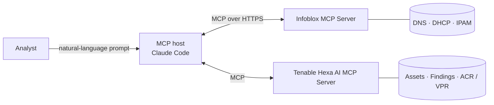

# Infoblox <> Tenable: MCP Use Cases

Correlate Tenable exposure data with authoritative Infoblox DNS, DHCP and IPAM identity, using natural-language prompts in an MCP-capable AI assistant.

This repository contains ready-to-run prompts, sample outputs and setup instructions for three joint workflows. The [Infoblox MCP Server](https://www.infoblox.com/products/iq/) and the [Tenable Hexa AI MCP Server](https://docs.tenable.com/exposure-management/Content/getting-started/hexa-AI-MCP.htm) are registered in a single MCP host (these examples use Claude Code). The assistant chains tool calls across both platforms and joins the results on IP and MAC address. No custom connector or middleware is required.

> [!NOTE]
> The sample outputs in this repository were captured in a lab environment.

## Use Cases

| # | Use Case | Question It Answers | Starts From |
|---|---|---|---|
| 1 | [Risk-Ranked Asset Triage](use-cases/01-risk-ranked-asset-triage/) | Which devices in a subnet should we fix first, and can we trust their network identity? | Subnet name or CIDR |
| 2 | [Identity Gap Analysis](use-cases/02-identity-gap-analysis/) | Which critical assets can't Tenable fully identify, and can Infoblox fill the gap? | Subnet name or CIDR |
| 3 | [MAC-to-Vulnerability Pivot](use-cases/03-mac-to-vulnerability-pivot/) | What device is behind this MAC address, and what is its full risk posture? | MAC address |

## How It Works



* Tenable supplies exposure context: assets, active findings, Asset Criticality Rating (ACR) and Vulnerability Priority Rating (VPR).
* Infoblox supplies authoritative network identity: subnet and IP space, DNS records, DHCP reservations and MAC addresses.
* The MCP host orchestrates calls to both servers, joins the data on IP and MAC address and returns a single answer.

More detail is in [docs/architecture.md](docs/architecture.md).

## Prerequisites

Infoblox

* An Infoblox Cloud Services Portal (CSP) account at [csp.infoblox.com](https://csp.infoblox.com)
* A CSP role with User Management and Service API Key permissions, needed to create a Service User and Service API key
* An active Universal DDI subscription (for IPAM, DNS and DHCP tools) and/or Threat Defense subscription (for security tools)
* A Service API key issued to a Service User with a read-only DDI role (recommended for these use cases)

Tenable

* Access to the Tenable Hexa AI MCP Server. See [Tenable's documentation](https://docs.tenable.com/exposure-management/Content/getting-started/hexa-AI-MCP.htm) for requirements and authentication.

MCP host

* [Claude Code](https://docs.anthropic.com/en/docs/claude-code) (recommended; connects to both servers natively over HTTP), or
* Claude Desktop (requires Node.js 20 or later for the `mcp-remote` proxy), or another MCP-compatible host

Step-by-step instructions are in [docs/setup.md](docs/setup.md).

## Quick Start (Claude Code)

```bash
# 1. Clone the repository
git clone https://github.com/<org>/infoblox-tenable-mcp-use-cases.git
cd infoblox-tenable-mcp-use-cases

# 2. Add your credentials (never commit this file)
cp config/.env.example .env
#    edit .env and fill in the values

# 3. Create the project MCP config
cp config/mcp.json.example .mcp.json

# 4. Load the environment variables and start Claude Code
set -a; source .env; set +a
claude

# 5. Inside Claude Code, confirm both servers show as connected
/mcp
```

Then run a use case with a slash command:

```text
/triage-subnet Engineering Subnet
/identity-gaps 10.20.30.0/24
/mac-pivot 00:50:56:b1:2d:9e
```

You can also paste the prompt from any use case's `prompt.md` file.

## Repository Layout

```text
.
├── README.md
├── LICENSE
├── SECURITY.md
├── .claude/commands/          # Claude Code slash commands, one per use case
├── config/
│   ├── .env.example           # credential placeholders
│   ├── mcp.json.example       # Claude Code project config for both MCP servers
│   └── claude_desktop_config.example.json
├── docs/
│   ├── setup.md
│   ├── architecture.md
│   ├── prompting-tips.md
│   └── troubleshooting.md
└── use-cases/
    ├── 01-risk-ranked-asset-triage/
    ├── 02-identity-gap-analysis/
    └── 03-mac-to-vulnerability-pivot/
        ├── README.md          # goal, steps, how to adapt
        ├── prompt.md          # copy-paste prompt with placeholders
        ├── sample-output.md   # sanitized lab result
        └── images/            # screenshots
```

## Good to Know

* Keep it read-only. The Infoblox MCP Server's write tools run immediately against your tenant, with no dry-run mode. Issue the Service API key to a Service User with a read-only role while you're trying these workflows.
* Check results before you act. AI-generated analysis can vary between runs. Treat each output as a prioritized starting point and confirm findings in the Infoblox Portal and Tenable before you remediate.
* Know where your data goes. Tool results are sent to the model provider configured in your MCP host. Follow your organization's AI and data-handling policies.
* Protect your credentials. Store API keys in environment variables or a secrets manager. `.env` and `.mcp.json` are listed in `.gitignore`.

## Resources

* [Infoblox IQ and the Infoblox MCP Server](https://www.infoblox.com/products/iq/)
* [Infoblox Security Ecosystem](https://www.infoblox.com/solutions/security-ecosystem/)
* [Infoblox Ecosystem Portal](https://ecosystem.infoblox.com/)
* [Tenable Hexa AI MCP Server documentation](https://docs.tenable.com/exposure-management/Content/getting-started/hexa-AI-MCP.htm)
* Blog post: <!-- TODO: add link once published -->

## Support

This repository provides example prompts and configurations for demonstration purposes. For product support, contact Infoblox Support or Tenable Support. To report a security issue, see [SECURITY.md](SECURITY.md).

## License

See [LICENSE](LICENSE).
