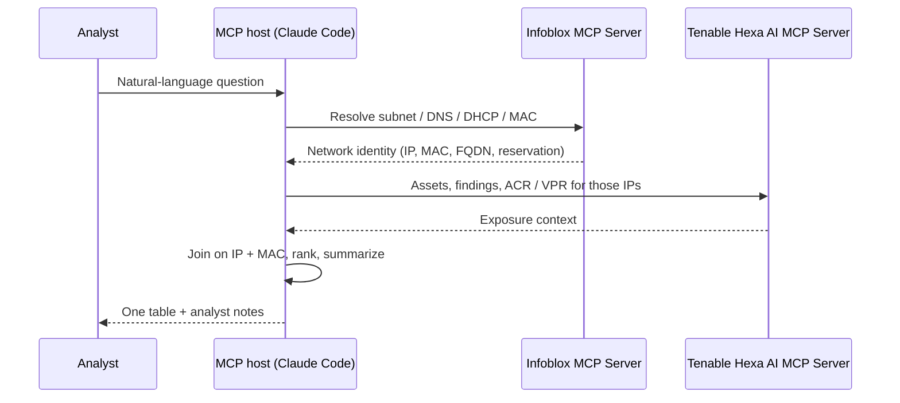

# Architecture

## Design

Both MCP servers are registered in a single MCP host. The host's model plans the investigation, calls tools on each server and correlates the results. Infoblox and Tenable don't talk to each other directly, and no middleware or custom connector sits between them.

| Layer | Component | Role |
|---|---|---|
| Interface | MCP host (Claude Code, Claude Desktop or another MCP client) | Accepts the analyst's question, plans tool calls, joins and summarizes results |
| Network identity | Infoblox MCP Server (`https://csp.infoblox.com/mcp`) | Authoritative IPAM, DNS and DHCP data: subnets, IP space, A records, fixed-address reservations, MAC addresses |
| Exposure | Tenable Hexa AI MCP Server | Assets, active and resurfaced findings, ACR, VPR, scan coverage |

## Join Keys

| Key | Infoblox Source | Tenable Source | Notes |
|---|---|---|---|
| IPv4 address | IPAM address / DHCP reservation / DNS A record | Asset IP | Primary key for every use case |
| MAC address | DHCP fixed-address reservation | Asset MAC | Confirms the IP still belongs to the same device |
| Hostname / FQDN | DNS A record | Asset hostname, FQDN or NetBIOS name | Often missing in Tenable for unauthenticated scan targets |
| Subnet | IPAM subnet name and CIDR | Asset IP range filter | Lets analysts ask by name ("engineering subnet") |

## Identity Status Labels

The use cases label each asset by which system can identify it:

| Label | Meaning |
|---|---|
| Confirmed in both systems | IP and MAC match between Tenable and an Infoblox reservation or record |
| Tenable-only | Tenable sees the asset, but Infoblox has no DNS record or DHCP reservation for it. The asset sits outside the IPAM system of record. |
| Infoblox-only | Tenable is missing the hostname or MAC, and Infoblox supplies it |
| Unresolved | Neither system can identify the asset |

## Infoblox MCP Tools Commonly Used

The Infoblox MCP Server exposes generic REST tools rather than a fixed list of task-specific tools. The model discovers endpoints at runtime. Tools typically used in these workflows:

* `list_all_available_services`, `get_service_info`, `get_method_info`: discover IPAM, DNS and DHCP endpoints
* `make_get_request`: read subnets, addresses, DNS records and DHCP fixed addresses
* `network_entity_search`: exact-match search for hosts, IPs, DNS records and assets
* `query_stored_data`: run SQL over previously retrieved responses

The exact tools the model picks can differ between runs.

## Security Considerations

* Use least privilege. Issue the Infoblox key to a Service User with a read-only role. The server's write tools run immediately and have no dry-run mode.
* Keep secrets out of files. Credentials are read from environment variables, and `.env` and `.mcp.json` are ignored by Git.
* Data leaves both platforms. Tool results are sent to the model provider configured in your MCP host. Confirm this is allowed under your data-handling policies.
* Rotate keys. To replace a key, issue a new one for the same Service User, update `.env`, restart the host, then revoke the old key.
